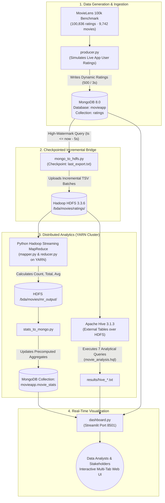
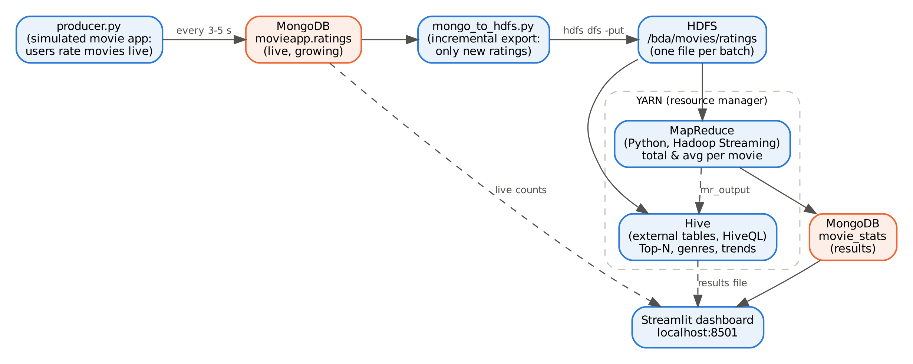

# Live Movie-Rating Analytics Pipeline — Hadoop MapReduce, Apache Hive & MongoDB

[](LICENSE)
[](https://www.python.org/)
[](https://hadoop.apache.org/)
[](https://hive.apache.org/)
[](https://www.mongodb.com/)
[](https://streamlit.io/)
[](https://github.com/itschiru07/live-movie-ratings-hadoop-hive/actions)

An enterprise-grade, end-to-end Big Data Analytics pipeline simulating and streaming real-time MovieLens ratings into **MongoDB**, performing checkpointed incremental batch ingestion into **Hadoop HDFS**, distributed aggregation using **Python MapReduce on YARN**, analytical querying with **Apache Hive external tables**, and presenting live analytics on an interactive **Streamlit** dashboard.

---

## 📑 Table of Contents
- [Project Overview & Academic Problem](#-project-overview--academic-problem)
- [System Architecture & Data Flow](#-system-architecture--data-flow)
- [Key Features & Engineering Highlights](#-key-features--engineering-highlights)
- [Tech Stack & Infrastructure](#-tech-stack--infrastructure)
- [Repository Structure](#-repository-structure)
- [Dataset & Simulation Logic](#-dataset--simulation-logic)
- [Step-by-Step Installation & Setup](#-step-by-step-installation--setup)
- [Execution Workflow (3-Terminal Run)](#-execution-workflow-3-terminal-run)
- [Analytical Hive Queries & Findings](#-analytical-hive-queries--findings)
- [Web Interfaces & Monitoring](#-web-interfaces--monitoring)
- [Project Defense & Viva Q&A](#-project-defense--viva-qa)
- [Author & License](#-author--license)

---

## 🎯 Project Overview & Academic Problem

Traditional academic implementations of Hadoop MapReduce operate on static text files loaded once into HDFS. In production data engineering, data arrives continuously from web applications, mobile devices, and IoT feeds.

**Big Data Analytics (BCS714D) — Assignment Question:**
> *Implement a MapReduce program to analyse a movie-rating dataset by calculating the total or average rating for each movie.*

### Core Engineering Requirements:
1. **Dynamic Streaming Source:** Instead of processing a static CSV, ratings arrive live in bursts into **MongoDB**.
2. **Incremental Batch Ingestion:** High-watermark checkpointing copies only newly arrived ratings from MongoDB into **Hadoop HDFS** with zero duplicate records.
3. **Distributed MapReduce on YARN:** Custom Python MapReduce streaming jobs compute `total_ratings`, `rating_sum`, and `avg_rating` per movie across distributed cluster worker nodes.
4. **Data Warehouse SQL Layer (Apache Hive):** External Hive tables mapped over HDFS run 7 complex multi-dimensional analytical queries (Top-N movies, genre breakdowns, arrival velocity, rating frequency distributions).
5. **Cross-Engine Verification:** MapReduce aggregation outputs are automatically joined and verified against Hive calculations (Q2 vs. Q3) to guarantee 100% calculation parity.
6. **Real-Time Operational Dashboard:** An interactive **Streamlit** dashboard visualizes real-time ingestion velocity, latest live ratings, top-rated movies, and Hive analytical graphs.

---

## 🏗️ System Architecture & Data Flow





---

## ⚡ Key Features & Engineering Highlights

- **Checkpointed Incremental Ingestion:** Records the highest exported timestamp in `last_export.txt` and enforces a 5-second buffer window (`last < ts <= now - 5s`). This guarantees **exactly-once processing** across streaming bursts without splitting in-flight batches.
- **Solving the Small Files Problem in HDFS:** High-frequency single-rating writes bypass HDFS and land in MongoDB; consolidated micro-batches are then synced into HDFS blocks, preserving NameNode memory.
- **Tab-Separated Serialization:** Solves CSV parsing errors caused by commas inside movie titles (e.g., *"Shawshank Redemption, The (1994)"*).
- **External Tables in Apache Hive:** Uses `CREATE EXTERNAL TABLE` pointing to HDFS folders. New ingestion files are queryable immediately with zero manual schema reloading.
- **Minimum Support Thresholds:** Eliminates outlier distortion in ranking queries using SQL `HAVING COUNT(*) >= 10` so movies with a single 5.0 rating do not dominate Top-10 leaderboards.
- **Dual-Engine Consistency Verification:** Automatically cross-verifies MapReduce output (`mr_movie_stats`) against independent Hive SQL aggregations, ensuring mathematical consistency across distributed frameworks.

---

## 🛠️ Tech Stack & Infrastructure

| Layer | Technology | Version | Description |
|---|---|---|---|
| **Distributed Storage** | Apache Hadoop HDFS | 3.3.6 | Resilient distributed filesystem for partitioned TSV batches |
| **Cluster Resource Manager** | Apache Hadoop YARN | 3.3.6 | Manages cluster node resources and schedules MapReduce jobs |
| **Distributed Compute** | Hadoop Streaming | 3.3.6 | Executes Python `mapper.py` and `reducer.py` across worker nodes |
| **Data Warehouse** | Apache Hive | 3.1.3 | Schema-on-read analytical querying engine with Derby metastore |
| **Document Database** | MongoDB | 8.0 | High-concurrency landing buffer for real-time ratings & stats cache |
| **Query CLI** | MongoSH | 2.14+ | Command-line management for MongoDB collections |
| **Language Runtime** | Python | 3.10 | Producer streaming, ingestion loader, MapReduce jobs, stats sync |
| **Java Runtime** | OpenJDK | 1.8 (Java 8) | Official runtime for Hadoop 3.3.6 and Hive 3.1.3 |
| **Web Dashboard** | Streamlit | 1.40+ | Real-time multi-tab dashboard with auto-refresh and metrics |
| **OS Environment** | Ubuntu 22.04 LTS | WSL2 | Linux subsystem running natively on Windows |
| **CI / CD** | GitHub Actions | Ubuntu Latest | Automated linting, syntax checking, and unit testing |

---

## 📁 Repository Structure

```text
├── .github/workflows/
│   └── ci.yml              # CI: Automated unit tests and syntax validation
├── docs/
│   ├── architecture.png    # High-level architecture workflow diagram
│   ├── HOW_IT_WAS_BUILT.md # Engineering design decisions, problems & solutions
│   ├── INSTALLATION.md     # Full step-by-step setup guide from zero on WSL2
│   └── RUNNING.md          # Everyday execution commands, monitoring, and tips
├── results/                # Benchmark text logs and outputs from MapReduce & Hive runs
│   ├── hive_113127.txt     # Sample Hive query output
│   └── mapreduce_113127.tsv# Sample MapReduce key-value aggregated output
├── tests/
│   └── test_mapreduce.py   # Automated unit tests for mapper and reducer logic
├── clear_data.sh           # One-click helper: Drops database & resets HDFS/local cache
├── dashboard.py            # Real-time multi-tab Streamlit web dashboard
├── download_dataset.sh     # One-click helper: Downloads and unpacks MovieLens 100k
├── fix_env.sh              # One-click recovery script for Hadoop/Hive/Java paths
├── Makefile                # Standardized CLI commands (make test, make start, etc.)
├── mapper.py               # MapReduce Mapper: parses TSV and emits (movieId, rating)
├── mongo_to_hdfs.py        # Incremental MongoDB to HDFS ingestion bridge
├── movie_analysis.hql      # 7 analytical Hive queries (Top-N, Genres, Trends)
├── producer.py             # Live rating generator simulating user app traffic
├── reducer.py              # MapReduce Reducer: computes count, sum, average per movie
├── requirements.txt        # Python package dependencies (pymongo, streamlit, pandas)
├── run_pipeline.sh         # Master orchestrator: Ingest -> MapReduce -> Sync -> Hive
├── setup_wsl.sh            # Automated WSL2 system provisioning script
├── start_all.sh            # One-click helper: Starts MongoDB, HDFS, and YARN
├── stats_to_mongo.py       # Syncs MapReduce TSV outputs back to MongoDB
├── LICENSE                 # MIT License
└── README.md               # Main project documentation
```

---

## 📊 Dataset & Simulation Logic

The core dataset is GroupLens Research's **[MovieLens 100k Dataset (ml-latest-small)](https://grouplens.org/datasets/movielens/latest/)**:
- **100,836 ratings** applied to **9,742 movies** across **610 users**.
- Timestamp span: 1996 to 2018, replayed with dynamic simulated timestamps.

### Collections in MongoDB (`movieapp`):

| Collection | Schema | Description |
|---|---|---|
| `movies` | `movieId` (Int), `title` (String), `genres` (String) | Preloaded movie catalogue with unique index on `movieId` |
| `ratings` | `userId` (Int), `movieId` (Int), `rating` (Double), `ts` (ISODate) | Ingested streaming ratings with indexed arrival timestamp |
| `movie_stats` | `movieId` (Int), `num_ratings` (Int), `total_rating` (Double), `avg_rating` (Double), `updated_at` (ISODate) | Computed MapReduce results synced back for rapid dashboard retrieval |

---

## ⚙️ Step-by-Step Installation & Setup

> **Full detailed instructions are available in [docs/INSTALLATION.md](docs/INSTALLATION.md).**

### 1. Prerequisites (Inside WSL2 Ubuntu 22.04)
Run the automated installation script:
```bash
bash setup_wsl.sh
```
*(Or install manually: OpenJDK 8, Hadoop 3.3.6, Hive 3.1.3, MongoDB 8.0, and Python 3.10).*

### 2. Configure Environment (`~/.bashrc`)
```bash
export JAVA_HOME=/usr/lib/jvm/java-8-openjdk-amd64
export HADOOP_HOME=$HOME/hadoop
export HIVE_HOME=$HOME/hive
export PDSH_RCMD_TYPE=ssh
export PATH=$PATH:$HADOOP_HOME/bin:$HADOOP_HOME/sbin:$HIVE_HOME/bin
```

### 3. Install Python Dependencies & Download Dataset
```bash
pip3 install -r requirements.txt
bash download_dataset.sh
```

### 4. Run Automated Unit Tests
```bash
python3 -m unittest discover -s tests -v
```

---

## 🚀 Execution Workflow (3-Terminal Run)

### Routine Startup
Start all required services with a single command:
```bash
bash start_all.sh
```
Verify that `jps` shows: `NameNode`, `DataNode`, `SecondaryNameNode`, `ResourceManager`, and `NodeManager`.

---

### Step 1: Open Terminal 1 — Streamlit Dashboard
```bash
python3 -m streamlit run dashboard.py --server.headless true
```
*Open **http://localhost:8501** in your browser.*

---

### Step 2: Open Terminal 2 — Stream Live Ratings
Simulate incoming ratings (streams 500 ratings every 3 seconds):
```bash
python3 producer.py ml-latest-small 500 3
```

---

### Step 3: Open Terminal 3 — Execute the Pipeline
Run the incremental ingestion, MapReduce computation on YARN, and Hive analytics:
```bash
bash run_pipeline.sh
```
Run `bash run_pipeline.sh` repeatedly while data is streaming to observe dynamic aggregation growth.

To reset the database and HDFS for a clean run:
```bash
bash clear_data.sh
```

---

## 📈 Analytical Hive Queries & Findings

The Hive script (`movie_analysis.hql`) executes 7 queries over external tables pointing to HDFS:

| Query | Objective | Key HiveQL Logic |
|---|---|---|
| **Q1** | **Ingestion Progress** | `COUNT(*)`, `COUNT(DISTINCT movie_id)`, `MIN(ts)`, `MAX(ts)` to measure live growth |
| **Q2** | **Top 10 Movies (Hive)** | `AVG(rating)` grouped by title `HAVING COUNT(*) >= 10` |
| **Q3** | **MapReduce Verification** | Joins MapReduce outputs (`mr_movie_stats`) with `movies` table to verify results match Q2 |
| **Q4** | **Most-Rated Movies** | Top movies by engagement volume |
| **Q5** | **Genre Breakdown** | `LATERAL VIEW explode(split(genres, '\\|'))` for normalized genre metrics |
| **Q6** | **Rating Distribution** | Frequency counts of ratings from 0.5 to 5.0 |
| **Q7** | **Arrival Velocity** | `GROUP BY date_format(ts, 'yyyy-MM-dd HH:mm')` measuring incoming velocity |

### Benchmark Results (Run 2 — 46,100 Live Ratings Processed)
- **Data Growth:** Scaled smoothly from 600 → 5,100 → 46,100 ratings across incremental runs.
- **Top-Rated Movie (min 10 ratings):** *The Shawshank Redemption (1994)* — **4.45** average rating (151 ratings).
- **Most-Rated Movie:** *Forrest Gump (1994)* — **160** ratings.
- **Genre Performance:** *Film-Noir* achieved the highest average rating (**3.95**), followed by *War* (**3.83**); *Horror* had the lowest (**3.25**).
- **Cross-Engine Parity:** MapReduce Top 10 results matched Hive Top 10 results with **100% precision**.

---

## 🌐 Web Interfaces & Monitoring

| Service | Address | Function |
|---|---|---|
| **Streamlit Dashboard** | `http://localhost:8501` | Live operational charts, live stream feed, and MapReduce/Hive metrics |
| **HDFS NameNode UI** | `http://localhost:9870` | HDFS filesystem explorer, block replication, data health |
| **YARN Cluster Manager** | `http://localhost:8088` | Active MapReduce container tracking, memory/core allocation |

---

## 🎓 Project Defense & Viva Q&A

<details>
<summary><b>1. Why did you use Hadoop Streaming with Python instead of native Java MapReduce?</b></summary>

Hadoop Streaming allows standard Unix executables to act as Mappers and Reducers using standard input (`sys.stdin`) and standard output (`sys.stdout`). This decouples business logic from Java boilerplate, allows native Python string manipulation, and makes the code modular and easily unit-testable without requiring Maven compilation.
</details>

<details>
<summary><b>2. Why use MongoDB as an intermediate buffer instead of writing directly to HDFS?</b></summary>

HDFS is an append-only distributed filesystem optimized for large, sequential file reads; writing thousands of individual rating events directly to HDFS causes the **"Small Files Problem"**, which exhausts NameNode memory (every block metadata entry occupies ~150 bytes in RAM). MongoDB provides high-throughput writes with sub-millisecond latency, which `mongo_to_hdfs.py` then micro-batches into consolidated TSV files in HDFS.
</details>

<details>
<summary><b>3. How does the pipeline handle incremental data without duplicate records?</b></summary>

`mongo_to_hdfs.py` tracks the latest exported timestamp in `last_export.txt`. On subsequent runs, it queries MongoDB using `{"ts": {"$gt": last, "$lte": cutoff}}` where `cutoff = now - 5 seconds`. This 5-second buffer ensures that a batch currently being written by `producer.py` is never partially ingested. Each batch is uploaded to HDFS as an independent timestamped TSV file.
</details>

<details>
<summary><b>4. How do Hive external tables pick up new data automatically?</b></summary>

The Hive external table `ratings` points to the HDFS directory `/bda/movies/ratings/`. In Hadoop and Hive, an external table over a directory reads **all files** residing in that directory at query execution time. When `mongo_to_hdfs.py` uploads a new TSV file, Hive includes the new records immediately without requiring any `ALTER TABLE` or table reloads.
</details>

<details>
<summary><b>5. How did you verify that MapReduce calculations are mathematically correct?</b></summary>

We implemented dual-engine cross-verification: Query 2 in Hive computes the Top 10 movies directly from the raw ratings in HDFS, while Query 3 reads the output generated by MapReduce (`mr_movie_stats`). Both queries produced identical results (*Shawshank Redemption* at 4.45 with 151 ratings), proving that the distributed MapReduce logic matches standard relational SQL aggregation.
</details>

---

## 👤 Author & License

- **Author:** **CHIRANJEEVI A** ([@itschiru07](https://github.com/itschiru07)) — Computer Science & Engineering, Gopalan College of Engineering & Management, Bengaluru.
- **Project Repository:** [https://github.com/itschiru07/live-movie-ratings-hadoop-hive](https://github.com/itschiru07/live-movie-ratings-hadoop-hive)
- **License:** Released under the [MIT License](LICENSE).
